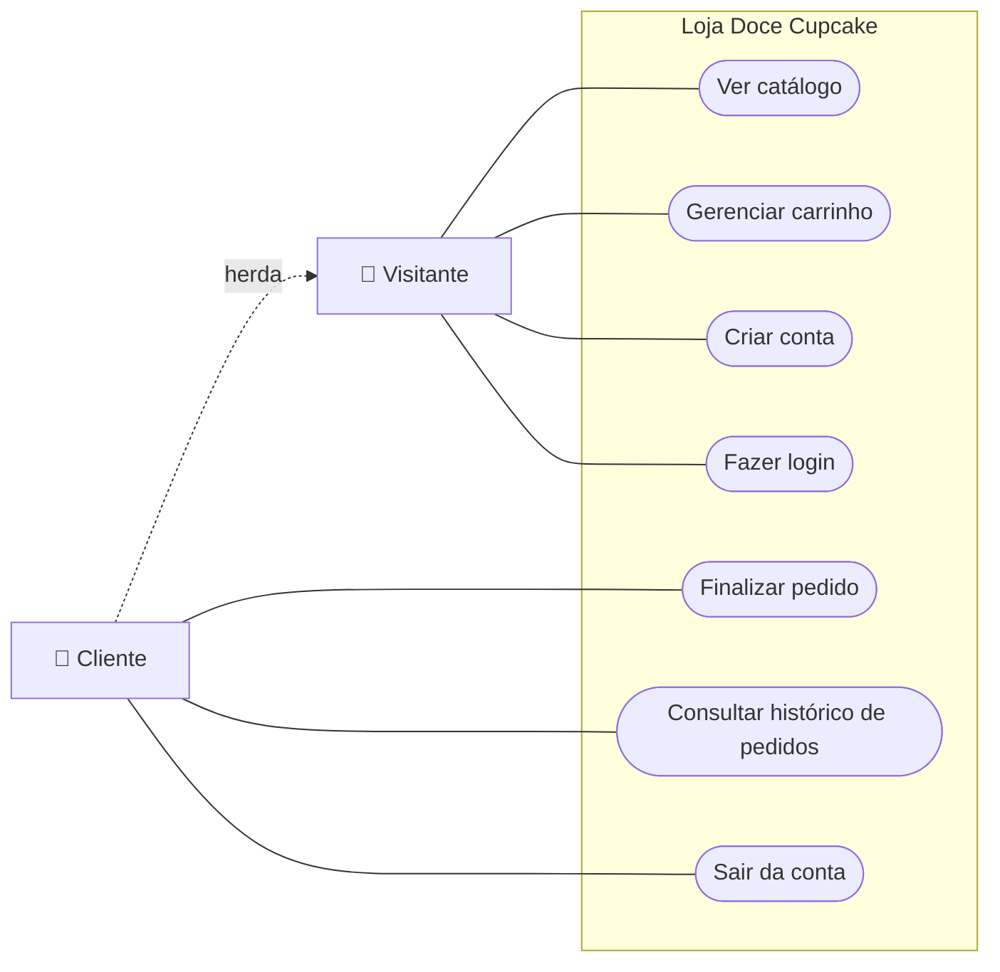

# Diagrama de Casos de Uso

**Atores**

- **Visitante:** qualquer pessoa que acessa o site sem estar autenticada.
- **Cliente:** visitante que possui conta e está autenticado. Herda todos os casos de uso do Visitante.

## Descrição dos casos de uso

| Código | Caso de uso | Ator | Descrição | Pré-condição |
| --- | --- | --- | --- | --- |
| UC1 | Ver catálogo | Visitante | Visualiza os cupcakes com nome, descrição e preço. | Nenhuma |
| UC2 | Gerenciar carrinho | Visitante | Adiciona produtos, altera quantidades e remove itens. O carrinho fica salvo no navegador. | Nenhuma |
| UC3 | Criar conta | Visitante | Cadastra nome, e-mail e senha. | E-mail ainda não cadastrado |
| UC4 | Fazer login | Visitante | Autentica-se com e-mail e senha. | Possuir conta |
| UC5 | Finalizar pedido | Cliente | Informa endereço e forma de pagamento e confirma o pedido. | Estar logado e ter itens no carrinho |
| UC6 | Consultar histórico | Cliente | Visualiza os pedidos realizados com itens, endereço, pagamento, total e data. | Estar logado |
| UC7 | Sair da conta | Cliente | Encerra a sessão. | Estar logado |

## Detalhamento: UC5 – Finalizar pedido

**Fluxo principal**

1. O cliente acessa o carrinho e clica em "Finalizar pedido".
2. O sistema verifica se o cliente está autenticado.
3. O sistema exibe o resumo do pedido e o formulário de entrega.
4. O cliente informa rua e número, complemento (opcional), bairro e cidade.
5. O cliente escolhe a forma de pagamento (Pix, cartão ou dinheiro na entrega).
6. O cliente clica em "Confirmar pedido".
7. O sistema valida os dados, busca os preços atuais no banco e calcula o total.
8. O sistema registra o pedido e seus itens.
9. O sistema esvazia o carrinho e exibe o número e o valor do pedido.

**Fluxos alternativos**

- **2a. Cliente não autenticado:** o sistema redireciona para o login e, após a autenticação, retorna ao checkout.
- **3a. Carrinho vazio:** o sistema informa que o carrinho está vazio e oferece o link para o catálogo.
- **7a. Endereço incompleto:** o sistema exibe "Preencha os dados de entrega." e não registra o pedido.
- **7b. Pagamento não selecionado:** o sistema exibe "Escolha uma forma de pagamento."
- **7c. Item inválido** (produto inexistente ou quantidade fora de 1 a 99): o sistema recusa o pedido e pede para atualizar a página.