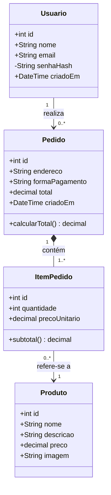
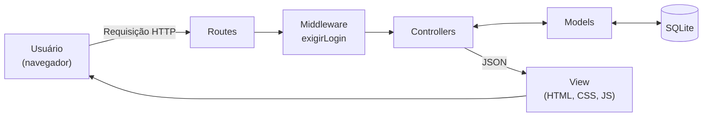

# Diagrama de Classes

## Classes de domínio (persistência)

**Relacionamentos**

- **Usuario → Pedido (associação, 1 para 0..\*):** um usuário pode realizar vários pedidos; cada pedido pertence a um único usuário.
- **Pedido ◆ ItemPedido (composição, 1 para 1..\*):** um pedido possui um ou mais itens. Os itens não existem sem o pedido.
- **ItemPedido → Produto (associação, 0..\* para 1):** cada item refere-se a um produto; um produto pode aparecer em vários itens.

**Observações de projeto**

- `senhaHash` é privado: a senha nunca é armazenada em texto puro, apenas o resultado da criptografia com bcrypt.
- `precoUnitario` guarda o preço no momento da compra, para que o histórico não mude se o preço do produto for alterado depois.
- O carrinho não é uma classe persistida: ele existe apenas no navegador (localStorage) até o pedido ser finalizado.

## Arquitetura MVC

| Camada | Arquivos | Responsabilidade |
| --- | --- | --- |
| Model | `src/models/*.js` | Acesso ao banco de dados (consultas e gravações) |
| View | `src/public/*` | Telas em HTML, CSS e JavaScript |
| Controller | `src/controllers/*.js` | Validações, regras de negócio e respostas da API |
| Routes | `src/routes/*.js` | Ligação entre endereços da API e controllers |
| Middleware | `src/middlewares/*.js` | Controle de acesso (exige login) |